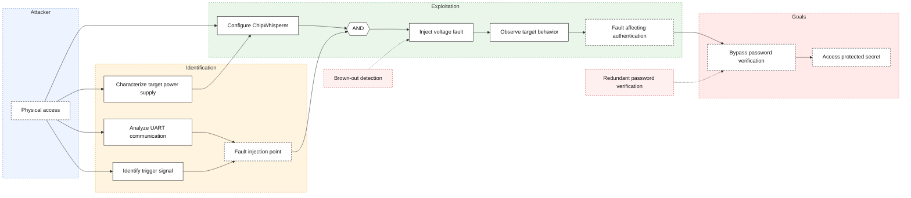

# Embedded Security Project — Attacking a Password-Protected Arduino Uno

> ⚠️ **Restructuring note**: this document reuses the content already written in your `README.md`, reorganized according to the requested plan. Sections marked `[TO COMPLETE]` correspond to elements expected by the course wiki (*Attack The Vault!* page) that you have not written yet. Before submitting, also double-check that you have the 5 minimum elements required by the teacher: asset description, attack tree, severity assessment (CVSS), attack(s) description/implementation, and proposed countermeasure(s).

---

## Introduction

This repository contains the work done for the Embedded Security Project, a course given in the 5MEO program at ECAM Brussels Engineering School.

The main objective of this project is to analyze and attack an Arduino Uno R3 from a hardware security perspective. The Arduino contains an unknown program protected by a password; the goal is to find vulnerabilities that allow bypassing this protection and retrieving the secret (hash + salt) stored in the firmware.

To achieve this, several attack techniques were explored:
- **Timing analysis**
- **Voltage Glitching**

This report documents the approach, experiments, results (both positive and negative), and conclusions drawn throughout the project.

---

## 1. Hardware Overview

- **Arduino Uno R3** — the target, with an **ATmega328P** microcontroller
- **ChipWhisperer Nano (CW-Nano)** — for synchronized measurements (power analysis) and hardware-triggered captures. This will be our weapon against the Arduino.
- **PC + Python 3.11 environment** — this is what we need to control the ChipWhisperer. More recent versions of Python (especially NumPy) can cause conflicts between the packages. I recommend using the environment I made.
- **Hardware components** — such as resistors and capacitors. They are needed for a better analysis when we remove the **ATmega328P** from the Arduino.

**Insert images of the modules!!!**

## 2. Before Getting Started — Identifying the Right Pins

The USB port does not work. We need to find another way to communicate with the target.
Before attacking anything, you need to know **what we are talking to**: which pin handles the password communication (RX/TX), and which pin can serve as a trigger signal to synchronize CW-Nano measurements with code execution. Of course, the classical TX and RX pins of the Arduino were not the pins used to enter the password; an error message says (**to be completed**). See the image below.
With the help of another student, the solution was simple. Using PulseView software and a little common sense, the TX port probably sends a welcome message at the beginning. We simply needed to analyse every signal from the Arduino's ports and see where there was communication (fluctuations of bits). There was communication on port 11. A simple check with the Tera Term software confirmed our intuition. The second port, RX, was found using a brute-force method. I simply tried sending nonsense to every port. A response was given by port 10. So pin 11 is **TX** and port 10 is **RX**. For the baud rate, I simply tested the standard convention; 9600 was the correct value. A more elegant way would be to deduce it from the frequency of the TX signal.

## 3. Attack Tree

---

## 4. Attack #1 — Timing Attack via UART

### Method

First approach: exploit the response time of the password verification routine over the UART interface, without any prior knowledge of the password.

All 94 printable ASCII characters were tested as possible first characters, each followed by a fixed-length padding sequence, and each candidate was tested 30 times.
The Python script can be found here (link to `timing_attack.py`).

### Result

- Measured response times: ~43.4 ms
- Standard deviations among the highest-ranked candidates: ranging from ~56 to ~135 µs
- Character with the highest median response time: `G`
- However, the difference between the top-ranked candidates was only a few microseconds, **not statistically significant**
- Repeated measurements gave completely different results each time, so the method was judged to be ineffective.

### Interpretation

Measuring response time via Python and USB-UART is **not precise enough** to reliably identify the correct character. At 9600 baud, sending 1 bit takes approximately 1 ms. In comparison, one clock cycle at 16 MHz is 62.5 ns. That is much shorter than the UART transmission time.

An improvement is to use the ChipWhisperer Nano to obtain measurements synchronized with the execution of the password verification routine, with the advantage of being less sensitive to electrical noise than software-side measurements on the PC. That will be the second attack.

---

## 5. Attack #1.2 — Power Analysis (SPA) with the ChipWhisperer Nano

### Method

**Hardware setup**: the ATmega328P was removed from the Arduino Uno board and placed on a breadboard to obtain a cleaner current measurement point, isolated from the rest of the circuit (USB-serial chip, voltage regulator, LEDs). The whole process is described in this repository (**add the link to the DLH GitHub repository**).

### Result

Even with communication working, `scope.capture()` consistently timed out (`Timeout in cwnano capture()`), regardless of whether the UART exchange itself succeeded.

**Root cause identified**: `scope.capture()` waits for a hardware trigger edge on `TIO4`, not for UART activity — sending bytes over UART alone does not trigger a capture. The firmware drives pin 13 (D13) HIGH before the password comparison and LOW right after (a usable trigger signal), but this pin was **not yet physically wired** to TIO4 (pin 16 of the CW-Nano's 20-pin connector) at the time of this session. No trigger edge ever reached the capture device, so a timeout means that no trigger edge was detected — not that the UART response was late. The notebook raises an actionable error in this case rather than attempting to plot an empty trace.

No trace could be recorded during this session; no secret has been recovered via this method yet.

### Conclusion

The targeted vulnerability (early-exit password comparison, see Section 6) is still believed to be exploitable via power analysis, but requires a proper trigger connection to be observable with the CW-Nano.

**Next steps**:
- Wire ATmega pin 19 (D13) to CW-Nano pin 16 (TIO4)
- Configure the scope: `scope.io.tio4 = 'high_z'`, `scope.trigger.triggers = 'tio4'`, `scope.adc.basic_mode = "rising_edge"`
- Re-attempt trace capture and visually compare traces for different candidate passwords before building a full brute-force script

### Expected results

Once the trigger is correctly wired, each capture window should correspond exactly to the time the firmware spends with pin 13 driven HIGH, i.e. the duration of `early_exit_compare()` (and, for a correct guess, the subsequent hashing routine as well). This matches the course's SPA methodology (see *SPA on RSA*, ES5T-T1/03): identify recurring patterns in the trace and map them back to the algorithm's branches.

**What a trace should look like**
- A short, mostly flat/low-activity region for most of the capture if the attempt fails on an early character, since `early_exit_compare()` returns almost immediately.
- A visibly **longer active region** (more oscillation / more instructions executed) when a leading character of the attempt matches the real password, because the comparison loop runs one more iteration before returning `false`.
- Once all 8 characters match, the trace should extend noticeably further still, covering `protected_section()`: salt generation (`random()` calls) and the SHA3-256 hashing of the secret — a clearly longer and busier trace than any failed attempt.

**What we are looking for, concretely**
- A usable metric is the **duration of the active/high-activity window** (e.g. number of samples above a baseline threshold, or simply the time between trigger high and trigger low if captured separately). This duration should increase monotonically as more leading characters of a guess match the real password — same principle as the `t_bad < t_correct` relationship shown for the PIN-pad example in the course, and the `Q`/`L` pattern mapping used for the RSA SPA example.
- For a fixed, fully wrong candidate character, repeated captures should be highly similar to each other (low variance) — this is the "this part of the trace stays highly similar" baseline mentioned in the course notes, and is a good sanity check before trusting the metric.

**Expected final deliverable**
- The recovered password, confirmed by sending it and observing `>> ACCESS GRANTED` instead of `>> ACCESS DENIED`.
- The hash and salt printed by `protected_section()` in response to the correct password, as required by the project's deliverables.
- A plot (saved from the Jupyter notebook) showing at least: one trace for a fully incorrect attempt, one trace for a partially correct attempt (1–2 leading characters correct), and one trace for the fully correct password — illustrating the growing active-region duration described above. This is the key piece of evidence for the "vulnerability correctly identified, with proof" criterion in the write-up grading grid.

`[TO COMPLETE]`: once the trigger is wired and traces have been obtained, fill in this section with your actual plots and the recovered password/hash/salt.

## 5. Attack #2 — Voltage Glitching

### Method

The objective of a voltage glitching attack is to intentionally disturb the microcontroller's power supply for a very short period in order to skip an instruction.

With the Arduino, the idea is to introduce a fault while the microcontroller is verifying the password, potentially causing it to accept an incorrect password.

### CVSS v4.0 Assessment

(just add an image?)
---

## 6. The Exploited Vulnerability — and Countermeasure Ideas

With the help of the source code, we can implement solutions at zero cost in order to make our embedded platform more robust.
All the corrections are documented in the code (make a patched and an unpatched version).

### The vulnerability: early exit

The program compares the password character by character and stops as soon as one character is incorrect. The more correct characters are entered, the more instructions the CPU executes — creating a measurable difference in **execution time** and **power consumption**, exploitable via timing attack or power analysis to progressively recover the password.

#### Countermeasures

1. **Constant-time comparison**: instead of stopping at the first incorrect character, the program always checks the entire password and only returns the result at the end. This removes the information leak tied to execution duration.
2. **Random delay before the response**: makes timing attacks harder, but **does not prevent** analysis of the CPU's power consumption. However, we can add random computations to the program to counter this.
3. **Limit the number of attempts**: add a maximum number of attempts before locking the platform for a while.

### The vulnerability: voltage glitch

The program does not implement any countermeasure against fault injection. A voltage glitch can cause the microcontroller to skip instructions, potentially bypassing the password check entirely.

#### Countermeasures

1. **Brown-Out Detection**: Implement a brown-out detection circuit to reset the microcontroller when the power supply drops below a certain threshold.
2. **Voltage Regulator**: Use a stable voltage regulator to ensure a consistent power supply, with decoupling capacitors to filter out noise and spikes.
3. **Redundant security**: Implement redundant systems to ensure that if one component fails, another can take over without compromising the security of the system, for example by using a flag.

### Other attacks
There are many different attacks that I did not implement, but I can mention them and their countermeasures.

#### Firmware extraction 
The password and secret are hardcoded in plaintext within the firmware. If an attacker manages to extract the ATmega328P's Flash memory, these sensitive values could be recovered through binary analysis.

**Countermeasures**: Enable the microcontroller's lock bits to restrict firmware readout and avoid storing sensitive credentials in plaintext.

#### Memory Exhaustion

The readLine() function uses a dynamically allocated String without limiting the input length. Since the ATmega328P has only 2 KB of SRAM, sending excessively long serial messages could exhaust available memory, cause instability, or lead to a Denial-of-Service (DoS).

**Countermeasures**: Replace dynamic strings with a fixed-size buffer, enforce a maximum input length, and implement a reception timeout.

## Conclusion

## Checklist Before Submitting

According to the course wiki, the minimal write-up must contain:
- [ ] Asset description (the secret: hash + salt)
- [x] Hardware necessary + interfacing schematics *(partial — complete Sections 1 and 5)*
- [x] Attack tree *(skeleton provided in Section 3, to adapt)*
- [x] Severity assessment (CVSS v4) — **not done yet, needs to be added**
- [x] Attack(s) description and implementation *(Sections 4 and 5)*
- [x] Proposed countermeasure(s) *(Section 6, needs deeper justification/demonstration)*
- [ ] Conclusion and lessons learned
- [ ] Rrearange the section in logical order