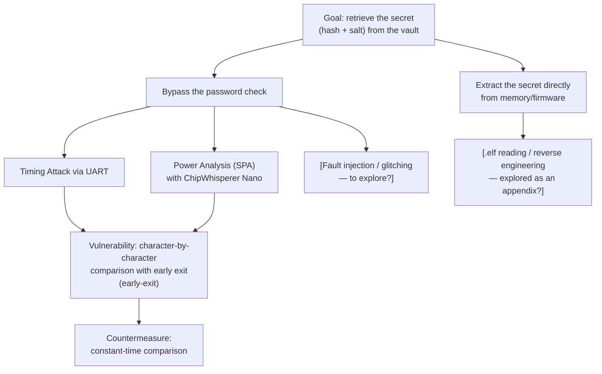

# Embedded Security Project — Attacking a Password-Protected Arduino Uno

> ⚠️ **Restructuring note**: this document reuses the content already written in your `README.md`, reorganized according to the requested plan. Sections marked `[TO COMPLETE]` correspond to elements expected by the course wiki (*Attack The Vault!* page) that you haven't written yet. Before submitting, also double-check you have the 5 minimum elements required by the teacher: asset description, attack tree, severity assessment (CVSS), attack(s) description/implementation, proposed countermeasure(s).

---

## Introduction

This repository contains the work done for the Embedded Security Project, a course given in the 5MEO program at ECAM Brussels Engineering School.

The main objective of this project is to analyze and attack an Arduino Uno R3 from a hardware security perspective. The Arduino contains an unknown program protected by a password; the goal is to find vulnerabilities that allow bypassing this protection and retrieving the secret (hash + salt) stored in the firmware.

To achieve this, several attack techniques were explored:
- **Timing analys** 
- **Voltage Glitching**

This report documents the approach, experiments, results (both positive and negative), and conclusions drawn throughout the project.

---

## 1. Hardware Overview

- **Arduino Uno R3** — the target, with an **ATmega328P** microcontroller
- **ChipWhisperer Nano (CW-Nano)** — for synchronized measurements (power analysis) and hardware-triggered captures. This will be our weapon against the arduinno
- **PC + Python 3.11 environment** this what we need to controll the ChipWhisperer. more recent versions of python (especillay NUmpy) can cause conflict between the packages. I recommende to use the environement I made. 
- **Hardware component** : such as Resistor and capacitor. it's needed for a better analys when we will remove the **ATmega328P** from the arduinno.

**inserer images des modules !!!**

## 2. Before Getting Started — Identifying the Right Pins

The USB port don't work. We need to find another way to communicate with the target. 
Before attacking anything, you need to know **what we are talking to**: which pin handles the password communication (RX/TX), and which pin can serve as a trigger signal to synchronize CW-Nano measurements with code execution. Of cours the classical Pin TX and RX of the arduinno weren't the pin in use to insert the password an error message say (**a completer**) see image below. 
With the help of other student the solution was simple. With the use of PulseView software and a little common sense the TX port probably send a welcome message a the begining. we have just need to analyse every signal of the port of arduinno and see where there was a communication (fluation of bits). there was communication on port 11. a simple check with the software Teraterm confirms our intuition. The second port RX was find with the brut force methode. I simply test to send bulshit on every port. A response was given by the port 10. So pin 11 for **TX** and port 10 for **RX**. for the baudrate simply test the generic convention, 9600 was the right. a More eleagante way can be to deduce it with the frequence of TX signal. 

### What was found by reading the firmware

Reading the firmware source code confirmed that:
- the password prompt is **not handled by the hardware UART** (`Serial`, 115200 baud, pins D0/D1) — that one only prints a welcome banner once at boot;
- the actual password communication channel is a **`SoftwareSerial`** instance (`comms`) on pins **D10/D11**, running at **9600 baud**, exchanging plain text (no SimpleSerial framing);
- pin **D13** is driven HIGH by the firmware right before the password comparison, then LOW right after → this is the usable **trigger** pin for the CW-Nano.

`[TO COMPLETE — important, the teacher demonstrated this in the lab]`: the *practical* method (without reading the source code, "black-box" style) for finding these pins yourself. For example:
- using a logic analyzer / software such as **PulseView** to observe pin activity at reset or during a connection attempt,
- a "trial and error" approach pin by pin, using an LED or a second Arduino as a UART interface,
- calculating/identifying the baud rate from the observed frames.

> If you did this step in the lab but haven't written it up yet: this is exactly the kind of section the teacher expects under "Hardware necessary to conduct your attack, as well as schematics describing their interfacing" (the *Reproducible* grading criterion — 10% of the write-up). Describe your process, even if it was empirical, and add a photo/screenshot if you have one.

---

## 3. Attack Tree

### What is it?

An **attack tree** is a diagram that starts from an **attacker's goal** (the root — here: *retrieve the secret stored in the vault*) and breaks it down into **sub-goals / possible attack paths**, down to concrete, actionable steps. Each branch represents a different way of reaching the goal (or a sub-goal), and can be annotated with:
- the **asset** targeted (what's being protected — here, the password / the hash+salt),
- the **vulnerabilities** exploited at each step,
- the **countermeasures** that would block each branch.

It's a threat-modeling tool: it shows that you considered several possible paths (not just the one you followed), and explicitly links attack ↔ vulnerability ↔ countermeasure (this is graded as a separate criterion in the grid: *Attack tree is complete* — 10%).

### Proposal for this project

Here's a skeleton based on what you've identified so far (GitHub natively renders Mermaid diagrams in `.md` files):

`[TO COMPLETE]`: adapt this skeleton to what you actually explored (add/remove branches), then paste it as-is into your `README.md` — no need for an external image, Mermaid renders directly on GitHub.

---

## 4. Attack #1 — Timing Attack via UART

### Method

First approach: exploit the response time of the password verification routine over the UART interface, without any prior knowledge of the password.

All 94 printable ASCII characters were tested as possible first characters, each followed by a fixed-length padding sequence, and each candidate was tested 30 times.

### Result

- Measured response times: ~43.4 ms
- Standard deviations among the highest-ranked candidates: ranging from ~56 to ~135 µs
- Character with the highest median response time: `G`
- However, the difference between the top-ranked candidates was only a few microseconds, **not statistically significant**
- Repeated measurements gave completely different results each time

### Conclusion

Measuring response time via Python and USB-UART is **not precise enough** to reliably identify the correct character. The next step is to use the ChipWhisperer Nano to obtain measurements synchronized with the execution of the password verification routine, with the advantage of being less sensitive to electrical noise than the software-side measurement on the PC.

---

## 5. Attack #2 — Power Analysis (SPA) with the ChipWhisperer Nano

> ⚠️ **Status: in progress / not yet successful at the time of writing.** This section documents a negative result — that's normal and still counts in a write-up (see grading grid: it's about showing the process, not just a success).

### Method

**Hardware setup**: the ATmega328P was desoldered from the Arduino Uno board and placed on a breadboard, to obtain a cleaner current measurement point, isolated from the rest of the circuit (USB-serial chip, voltage regulator, LEDs).

The support signals needed for the chip to run were wired back to the now-empty DIP-28 socket on the Arduino (reusing the board's oscillator, reset circuitry, and power supply):
- RESET (pin 1), XTAL1/XTAL2 (pins 9/10), VCC/AVCC (pins 7/20), GND (pins 8/22)
- D10 (pin 16, RX of the `comms` channel) and D11 (pin 17, TX) wired directly to the CW-Nano

**CW-Nano wiring (20-pin connector)**:

| CW-Nano pin | Function | Connected to |
|---|---|---|
| 2 | GND | common ground |
| 8 | VREF | chip VCC (5V) |
| 10 | TIO1 (RX) | ATmega pin 17 (D11, firmware TX) |
| 12 | TIO2 (TX) | ATmega pin 16 (D10, firmware RX) |

**Communication issue and fix**: initial capture attempts used `cw.target(scope, cw.targets.SimpleSerial2)` with `target.write()` / `target.read()`, which returned empty responses. These methods encode/decode the structured SimpleSerial protocol (start byte, command character, checksum), which this custom firmware doesn't implement at all. Switching to the raw serial accessor (`target.ser.write()` / `target.ser.read()`) fixed communication at the protocol level — consistent with the *Troubleshooting* section of the course wiki.

### Result

Even with communication working, `scope.capture()` consistently timed out (`Timeout in cwnano capture()`), regardless of whether the UART exchange itself succeeded.

**Root cause identified**: `scope.capture()` waits for a hardware trigger edge on `TIO4`, not for UART activity — sending bytes over UART alone does not trigger a capture. The firmware does drive pin 13 (D13) HIGH before the password comparison and LOW right after (a usable trigger signal) — but this pin was **not yet physically wired** to TIO4 (pin 16 of the CW-Nano's 20-pin connector) at the time of this session. No trigger edge ever reached the capture device, so a timeout means no trigger edge was detected — not that the UART response was late. The notebook raises an actionable error in this case rather than attempting to plot an empty trace.

No trace could be recorded during this session; no secret has been recovered via this method yet.

### Conclusion

The targeted vulnerability (early-exit password comparison, see Section 6) is still believed to be exploitable via power analysis, but requires a proper trigger connection to be observable with the CW-Nano.

**Next steps**:
- Wire ATmega pin 19 (D13) to CW-Nano pin 16 (TIO4)
- Configure the scope: `scope.io.tio4 = 'high_z'`, `scope.trigger.triggers = 'tio4'`, `scope.adc.basic_mode = "rising_edge"`
- Re-attempt trace capture and visually compare traces for different candidate passwords before building a full brute-force script

### Expected results

Once the trigger is correctly wired, each capture window should correspond exactly to the time the firmware spends with pin 13 driven HIGH, i.e. the duration of `early_exit_compare()` (and, on a correct guess, the subsequent hashing routine as well). This matches the course's SPA methodology (see *SPA on RSA*, ES5T-T1/03): identify recurring patterns in the trace and map them back to the algorithm's branches.

**What a trace should look like**
- A short, mostly flat/low-activity region for most of the capture if the attempt fails on an early character, since `early_exit_compare()` returns almost immediately.
- A visibly **longer active region** (more oscillation / more instructions executed) when a leading character of the attempt matches the real password, because the comparison loop runs one more iteration before returning `false`.
- Once all 8 characters match, the trace should extend noticeably further still, covering `protected_section()`: salt generation (`random()` calls) and the SHA3-256 hashing of the secret — a clearly longer and busier trace than any failed attempt.

**What we are looking for, concretely**
- A usable metric is the **duration of the active/high-activity window** (e.g. number of samples above a baseline threshold, or simply the time between trigger high and trigger low if captured separately). This duration should increase monotonically as more leading characters of a guess match the real password — same principle as the `t_bad < t_correct` relationship shown for the PIN-pad example in the course, and the `Q`/`L` pattern mapping used for the RSA SPA example.
- For a fixed, fully-wrong candidate character, repeated captures should be highly similar to each other (low variance) — this is the "this part of the trace stays highly similar" baseline mentioned in the course notes, and is a good sanity check before trusting the metric.

**Expected final deliverable**
- The recovered password, confirmed by sending it and observing `>> ACCESS GRANTED` instead of `>> ACCESS DENIED`.
- The hash and salt printed by `protected_section()` in response to the correct password, as required by the project's deliverables.
- A plot (saved from the Jupyter notebook) showing at least: one trace for a fully incorrect attempt, one trace for a partially correct attempt (1–2 leading characters correct), and one trace for the fully correct password — illustrating the growing active-region duration described above. This is the key piece of evidence for the "vulnerability correctly identified, with proof" criterion in the write-up grading grid.

`[TO COMPLETE]`: once the trigger is wired and traces obtained, fill in this section with your actual plots and the recovered password/hash/salt.

---

## 6. The Exploited Vulnerability — and Countermeasure Ideas

### The vulnerability: early exit

The program compares the password character by character and stops as soon as one character is incorrect. The more correct characters are entered, the more instructions the CPU executes — creating a measurable difference in **execution time** and **power consumption**, exploitable via timing attack or power analysis to progressively recover the password.

### Proposed countermeasures

1. **Constant-time comparison**: instead of stopping at the first incorrect character, the program always checks the entire password and only returns the result at the end. Removes the information leak tied to execution duration.
2. **Random delay before the response**: makes timing attacks harder, but **does not prevent** analysis of the CPU's power consumption (the leak is still present in the power trace — only the *network-side* timing is obscured).
3. `[TO COMPLETE / optional]` other avenues to consider: masking operations (making power consumption independent of the processed value), adding hardware noise (filtered power supply, capacitors), anomaly detection (watchdog / brown-out detection) to react to an analysis attempt.

`[TO COMPLETE — grading criterion "The proposed counter-measure would indeed void the exploit"]`: for each chosen countermeasure, explain **why** it concretely blocks *your* attack (not just in theory), and if possible, demonstrate it (re-implementation + renewed attack attempt, see course planning sessions 4–5).

---

## Conclusion

`[TO COMPLETE]` — to be written once Attack #2 is successful. Points to cover:
- Summary of both approaches attempted and their respective results (controlled failure for timing, in progress for power analysis)
- Was the secret recovered? If so, how (hash + salt obtained); if not, where things currently stand
- Limitations encountered (software precision, trigger wiring, etc.)
- What the project revealed about the hardware security of a low-end microcontroller
- Link to the severity assessment (CVSS) and the attack tree completed above

---

## Checklist Before Submitting

According to the course wiki, the minimal write-up must contain:
- [ ] Asset description (the secret: hash + salt)
- [x] Hardware necessary + interfacing schematics *(partial — complete Sections 1 and 5)*
- [x] Attack tree *(skeleton provided in Section 3, to adapt)*
- [ ] Severity assessment (CVSS v4) — **not done yet, needs to be added**
- [x] Attack(s) description and implementation *(Sections 4 and 5)*
- [~] Proposed countermeasure(s) *(Section 6, needs deeper justification/demonstration)*
