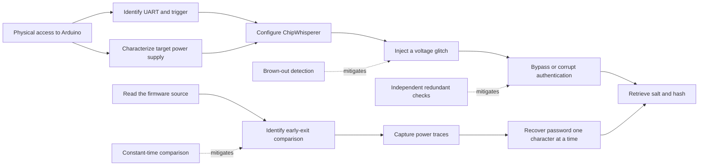

# Embedded Security Project: Attacking an Arduino Vault

This repository contains our work for the Embedded Security Project in the
5MEO program at ECAM Brussels Engineering School.

The target is an Arduino Uno R3 running an unknown password-protected
application. When the correct password is entered, the vault returns a salt
and the SHA3-256 hash of a secret phrase. The objective is to identify an
attack path, retrieve the protected asset, assess the vulnerability, and
implement countermeasures on the original firmware.

The write-up follows the order used during the project:

1. understand the target and its interfaces;
2. perform a physical voltage-glitching attack;
3. retrieve and analyse the source code;
4. implement a secondary single-power-analysis (SPA) attack;
5. compare the original and patched firmware.

## 1. Target and protected asset

The target is an **Arduino Uno R3** based on an **ATmega328P**. Its firmware
contains:

- a password used to protect the vault;
- a secret phrase stored in the program;
- a routine that generates a four-byte salt and returns the SHA3-256 digest of
  the secret after successful authentication.

The protected asset is therefore the secret phrase and, in particular, the
salt/hash response returned by the vault. The password itself is also a
confidential value because it controls access to this response.

The unpatched firmware is available in
[`source_code/source_code_not_patched.ino`](source_code/source_code_not_patched.ino).
The modified firmware is available in
[`source_code/source_code_patched.ino`](source_code/source_code_patched.ino).

## 2. Hardware and communication setup

The equipment used for the attacks is:

- Arduino Uno R3 with an ATmega328P;
- ChipWhisperer Nano for synchronized power measurements and fault injection;
- a PC running Python 3.11;
- a USB-to-UART connection;
- a breadboard, wires, resistors, and capacitors when the ATmega328P is
  measured separately from the Arduino board;
- PulseView and a serial terminal for initial signal identification.

The firmware does not use the Arduino's usual serial interface for the vault
conversation. It uses `SoftwareSerial`:

| Signal | ATmega328P pin | Purpose |
|---|---:|---|
| RX | D10 | Receives password attempts |
| TX | D11 | Sends prompts and responses |
| Trigger | D13 | Goes HIGH during password verification |

The communication speed is 9600 baud. Pin D13 is useful as a trigger for the
ChipWhisperer because the firmware sets it HIGH immediately before checking
the password and LOW immediately afterwards.

The Python UART helper is in
[`UART_connection.py`](UART_connection.py). The SPA experiments are documented
in [`spa_vault_attack.ipynb`](spa_vault_attack.ipynb).

## 3. Attack tree

The attacker has physical access to the target and wants to bypass password
verification and obtain the protected response.



The primary attack is voltage glitching because it targets the running
authentication code without requiring knowledge of the source. SPA is the
secondary attack: it becomes possible to design it precisely after examining
the source code.

## 4. Primary attack: voltage glitching

### 4.1 Rationale

Voltage glitching is a fault-injection attack. The attacker briefly disturbs
the supply voltage while the microcontroller is executing the authentication
routine. If the disturbance affects a comparison or a conditional branch, the
processor may skip or corrupt an instruction and accept an invalid password.

This attack is particularly relevant to the target because the original
firmware performs authentication in a short, repeatable code region. The
ChipWhisperer Nano can be used to synchronize the disturbance with the
verification window.

### 4.2 Procedure

The attack setup is:

1. connect the UART lines to D10 and D11;
2. connect D13 to the ChipWhisperer trigger input;
3. observe the trigger and characterize the normal verification window;
4. configure the ChipWhisperer to apply short voltage disturbances at
   different delays and widths;
5. send an invalid password for each trial;
6. record whether the response is `ACCESS DENIED`, `ACCESS GRANTED`, or a
   device reset;
7. repeat successful-looking trials to distinguish a real bypass from noise
   or communication errors.

The expected proof of exploitation is an `ACCESS GRANTED` response for an
invalid password, followed by the salt and hash produced by
`protected_section()`.

The voltage-glitching experiment must be reported with the measured
parameters and a capture or log of the successful trial. A failed trial is
still useful because it documents the search space and the limitations of the
equipment; it must not be presented as a successful bypass.

### 4.3 Severity assessment

The attack requires physical access and specialized equipment, but it can
compromise authentication and disclose the protected asset. The proposed
CVSS v4.0 characterization is:

```text
AV:P/AC:H/AT:P/PR:N/UI:N/VC:H/VI:H/VA:L/SC:N/SI:N/SA:N
```

This vector reflects a physically present attacker, a difficult and
parameter-sensitive fault injection, no privileges or user interaction, and
high confidentiality and integrity impact on the vault. The final numerical
score should be calculated with the official CVSS v4 calculator and included
with the measurement results.

## 5. Source-code analysis

The source code explains why both attacks are possible.
[`source_code/source_code_not_patched.ino`](source_code/source_code_not_patched.ino)
compares the attempt character by character:

```cpp
for (size_t i = 0; i < pass_len; ++i) {
  if (attempt[i] == '\0') return false;
  if (attempt[i] != PASSWORD[i]) return false;
}
```

The function returns as soon as it finds a mismatch. Consequently:

- an attempt with a correct prefix executes more instructions;
- the execution time depends on the length of the correct prefix;
- the same difference can appear in the power trace;
- a fault affecting a comparison or branch can potentially change the
  authentication result.

The firmware also drives D13 HIGH around the verification, which provides a
repeatable measurement trigger.

## 6. Secondary attack: single power analysis (SPA)

### 6.1 Objective

SPA uses the power consumption of the microcontroller during one execution to
distinguish different control-flow paths. Here, the early-exit comparison
creates a progressively longer active region when more leading characters are
correct.

### 6.2 Method

The ATmega328P is measured on a breadboard when necessary, to reduce
interference from the Arduino board, USB interface, regulator, and LEDs. The
ChipWhisperer is configured to:

```python
scope.io.tio4 = "high_z"
scope.trigger.triggers = "tio4"
scope.adc.basic_mode = "rising_edge"
```

For each candidate password:

1. send the candidate through the UART interface;
2. capture the trace between the rising edge on D13 and the end of the
   verification window;
3. repeat the capture to measure noise and variance;
4. compare the duration and shape of the active region;
5. keep the character that produces the longest consistent prefix and move to
   the next position.

A useful first metric is the number of samples above a baseline threshold.
Incorrect candidates should produce a short trace, while candidates with a
longer correct prefix should produce a longer trace. A fully correct password
also executes `protected_section()`, including salt generation and SHA3-256,
so its trace should be longer and busier.

### 6.3 Results and limitations

The initial UART timing experiment is implemented in
[`Timing_Attack/timing_attack.py`](Timing_Attack/timing_attack.py). Measurements
made from Python over a 9600-baud serial link were dominated by transmission,
USB, and operating-system timing. The small differences between candidates
were not stable enough to recover the password reliably.

SPA addresses this limitation by measuring the target execution directly.
However, `scope.capture()` only works when the D13 trigger is physically
connected to the ChipWhisperer trigger input. A timeout means that no trigger
edge was detected; it does not demonstrate that the authentication routine is
too slow.

The SPA result must be demonstrated with:

- a trace for a completely wrong candidate;
- a trace for a candidate with a partially correct prefix;
- a trace for the correct password;
- the recovered password and the resulting salt/hash response.

The notebook contains the current capture and analysis workflow. Any result
that has not yet been measured should be labelled as an expected result rather
than a completed attack.

## 7. Countermeasures and updated firmware

The patched firmware is in
[`source_code/source_code_patched.ino`](source_code/source_code_patched.ino).
It addresses the two observed attack surfaces.

### 7.1 Constant-time comparison

The patched comparison checks every password character and accumulates all
mismatches instead of returning on the first mismatch. It also checks the
length after the loop. This removes the secret-dependent early exit that
enables timing analysis and makes the main comparison trace less informative.

### 7.2 Redundant verification

The patch repeats the comparison in reverse order and grants access only when
both independent checks succeed. A single corrupted result is therefore less
likely to bypass authentication.

This is fault tolerance, not a complete protection against a determined
attacker. An attacker may still target both checks, the final branch, or
another instruction.

### 7.3 Hardware countermeasures

Possible hardware improvements include:

- enabling the ATmega328P brown-out detector;
- using a stable voltage regulator and suitable decoupling;
- monitoring and resetting the device after abnormal supply conditions;
- adding an attempt limit or lockout mechanism.

The effectiveness of the countermeasure should be demonstrated by repeating
the relevant attack against the patched firmware and showing that the
original success condition no longer occurs.

## 8. Other observations

The firmware contains additional issues that are outside the two main attacks:

- sensitive values are stored in the firmware and could be recovered through
  flash extraction if readout protection is not enabled;
- `readLine()` uses a dynamically allocated `String`, which can cause memory
  pressure on the ATmega328P's 2 KB of SRAM when receiving uncontrolled input.

These observations are included as security improvements, not as substitutes
for the primary and secondary attacks required by the project.

## 9. Conclusion

The project combines a hardware fault-injection attack with a source-guided
side-channel attack. Voltage glitching is the primary attack because it can
directly target the authentication decision. Source-code analysis then
reveals the early-exit comparison, which motivates SPA as a secondary attack.

The final submission should connect each claim to experimental evidence:
hardware and schematics, the completed attack tree, CVSS v4 assessment,
successful retrieval of the protected response, and a comparison between the
original and patched firmware.
