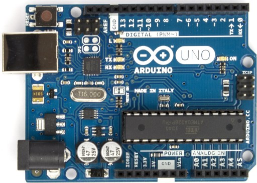
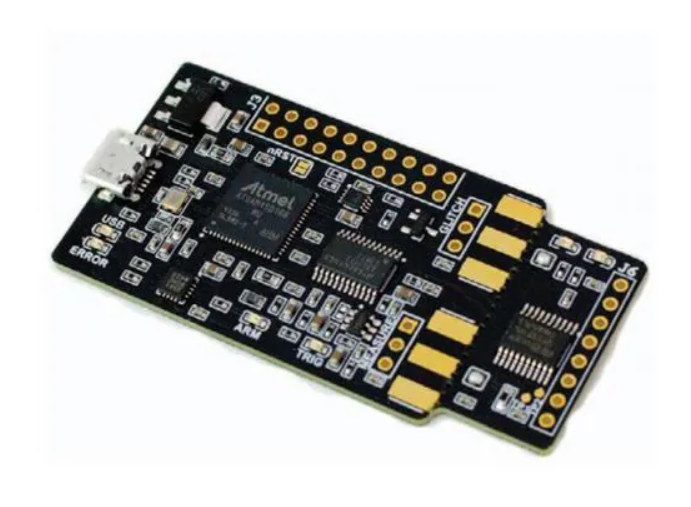
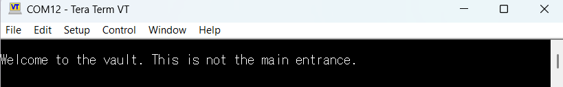
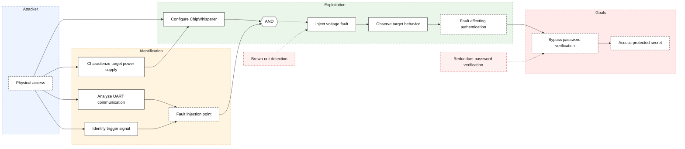

# Embedded Security Project — Attacking a Password-Protected Arduino Uno

---

## Introduction

This repository contains the work done for the Embedded Security Project, a course given in the 5MEO program at ECAM Brussels Engineering School.

The main objective of this project is to analyze and attack an Arduino Uno R3 from a hardware security perspective. The Arduino contains an unknown program protected by a password; the goal is to find vulnerabilities that allow bypassing this protection and retrieving the secret (hash + salt) stored in the firmware.

To achieve this, several attack techniques were explored:
- **Voltage Glitching**
- **Timing analysis**

This report documents the approach, experiments, results (both positive and negative), and conclusions drawn throughout the project.

---

## Repository Structure

This repository contains all the code and documentation used during the project. Each folder corresponds to a different part of the work.

- **`Timing_Attack/`**: Contains the Python script used for the timing attack and the Jupyter notebook for the power analysis on the ATmega328P.

- **`image/`**: Contains the images used to illustrate the report, including pictures of the hardware and experimental setup.

- **`source_code/`**: Contains the original Arduino firmware (`source_code_not_patched.ino`) and the modified version (`source_code_patched.ino`) with the proposed security improvements.

- **`voltage_glitch/`**: Contains the Jupyter notebook used to prepare and test the voltage glitching attack with the ChipWhisperer Nano.

- **`UART_connection.py`**: Python script used to communicate with the Arduino through the UART interface.

- **`spa_vault_attack.ipynb`**: Jupyter notebook used to experiment with the ChipWhisperer Nano and Simple Power Analysis (SPA). Keep for information purposes but it is not used in the final report.

- **`requirements.txt`**: Lists the Python libraries needed to run the scripts and notebooks.

- **`README.md`**: The main project report, explaining the attacks, experiments, results, and conclusions.

- **`.gitignore`**: Specifies which temporary or unnecessary files Git should ignore.

- **`LICENSE`**: Contains the license information for the repository.
---

## 1. Hardware Overview

- **Arduino Uno R3** — the target, with an **ATmega328P** microcontroller

- **ChipWhisperer Nano (CW-Nano)** — for synchronized measurements (power analysis) and hardware-triggered captures. This will be our weapon against the Arduino.

- **PC + Python 3.11 environment** — this is what we need to control the ChipWhisperer. More recent versions of Python (especially NumPy) can cause conflicts between the packages. I recommend using the environment I made.
- **Hardware components** — such as resistors and capacitors. They are needed for a better analysis when we remove the **ATmega328P** from the Arduino and make a RC filter.

## 2. Before Getting Started — Identifying the Right Pins

The USB port does not work. We need to find another way to communicate with the target.
Before attacking anything, you need to know **what we are talking to**: which pin handles the password communication (RX/TX), and which pin can serve as a trigger signal to synchronize CW-Nano measurements with code execution. Of course, the classical TX and RX pins of the Arduino were not the pins used to enter the password; an error message says (**welcome to the vaulnt. This is not the main entrance.**).
With the help of another student, the solution was simple. Using PulseView software and a little common sense, the TX port probably sends a welcome message at the beginning. We simply needed to analyse every signal from the Arduino's ports and see where there was communication (fluctuations of bits). There was communication on port 11. A simple check with the Tera Term software confirmed our intuition. The second port, RX, was found using a brute-force method. I simply tried sending nonsense to every port. A response was given by port 10. So pin 11 is **TX** and port 10 is **RX**. For the baud rate, I simply tested some standard conventions; 9600 was the correct value. A more elegant way to find baud rate would be to deduce it from the frequency of the TX signal.

## 3. Attack Tree

---

## 4. Attack #1 — Voltage Glitching

### Objective

The objective of this attack is to bypass the password verification mechanism of the Arduino Uno using voltage glitching, without knowing the correct password.

### What is Voltage Glitching?

Voltage glitching is a fault injection technique that consists of briefly disturbing the power supply of a microcontroller during its execution.

By introducing a short voltage drop at a specific moment, we can potentially cause the CPU to execute instructions incorrectly, skip an instruction, or modify the expected program behaviour.

In our case, the objective is to inject a voltage glitch while the ATmega328P is checking the password, potentially bypassing the authentication mechanism and executing the protected section of the program.

### Method

We use a **ChipWhisperer Nano (CW-Nano)** to perform the attack. Its built-in MOSFET can briefly pull the target's supply voltage towards ground, creating a controlled voltage disturbance.

The planned attack consists of three steps:

**1. Synchronization**

First, we need to synchronize the ChipWhisperer with the Arduino's execution.

The firmware uses pin D13 as a trigger signal, which is expected to transition HIGH when the password comparison begins.

By connecting D13 to the ChipWhisperer's TIO4 input, we should be able to detect this rising edge and synchronize our measurements.

**2. Power Analysis**

Once synchronization is working, we can capture the power consumption of the ATmega328P while sending an incorrect password.

By analyzing the power traces, we aim to identify the different execution phases and determine when the password comparison takes place.

This should help us identify the most relevant time window for fault injection.

**3. Voltage Glitch Injection**

Once the critical execution window has been identified, we can use the ChipWhisperer Nano to inject a short voltage glitch during the password verification.

By varying the injection timing and pulse duration, we would attempt to disturb the execution of the comparison routine.

The UART response would then be monitored to determine whether the Arduino rejects the password, resets, or unexpectedly grants access.

### Experimental Limitation

Unfortunately, we encountered a synchronization problem during our experiments with chipwhisperer.

Despite connecting the trigger signal and configuring the ChipWhisperer Nano, we were unable to detect the expected rising edge on TIO4.

Consequently, `scope.capture()` consistently timed out, preventing us from recording synchronized power traces.

Since we could not identify the password verification window, **the voltage glitch injection phase was not performed**.

### Expected Results

Three main outcomes would have been possible:

1. **Normal operation:** The Arduino rejects the incorrect password and returns `ACCESS DENIED`. This would indicate that the voltage glitch did not affect the authentication decision.

2. **System instability:** The Arduino resets, crashes, or stops responding. This would indicate that the voltage disturbance affected the microcontroller, but did not produce the intended authentication bypass.

3. **Successful authentication bypass:** The Arduino accepts an incorrect password and executes the protected section of the firmware, returning the secret hash and salt. This would demonstrate a successful fault injection attack.

The ultimate objective would have been to identify a reproducible combination of glitch timing and pulse width that bypasses password verification without causing the microcontroller to reset.

## 5. Severity of the Attack

### CVSS v4.0 Base Metrics

This assessment considers a hypothetical successful voltage glitching attack against the Arduino Uno R3.

The objective is to bypass the password verification mechanism by injecting a short voltage disturbance during the authentication process. If successful, the attacker could access the protected hash and salt without knowing the correct password.

**Exploitability**

- **AV:P — Physical:** The attacker requires physical access to the Arduino and its power supply to connect the ChipWhisperer Nano and inject voltage faults.
- **AC:L — Low:** Assuming the absence of effective fault injection countermeasures, no additional security mechanism needs to be circumvented once the attack setup has been established.
- **AT:P — Present:** Successful exploitation depends on injecting the voltage glitch during a specific execution window. Several attempts may be necessary to trigger the desired execution fault.
- **PR:N — None:** No password or prior authentication is required to perform the attack.
- **UI:N — None:** The attack does not require interaction from another user.

**Impact on the Arduino**

- **VC:H — High:** A successful authentication bypass would allow the attacker to retrieve the protected hash and salt, compromising the confidentiality of the project's protected asset.
- **VI:N — None:** The assumed attack does not involve persistent modification of the firmware or stored data.
- **VA:N — None:** The successful attack scenario does not involve a demonstrated loss of availability. Temporary resets or crashes during unsuccessful glitch attempts are not included in this assessment.

**Impact on subsequent systems**

- **SC:N — None:** No other system's confidential information is exposed.
- **SI:N — None:** No other system's integrity is affected.
- **SA:N — None:** No other system's availability is affected.

**Base vector**

`CVSS:4.0/AV:P/AC:L/AT:P/PR:N/UI:N/VC:H/VI:N/VA:N/SC:N/SI:N/SA:N`

The resulting CVSS v4.0 Base Score is **4.1 (Medium)**.

Score calculated using the [NVD CVSS v4.0 Calculator](https://nvd.nist.gov/vuln-metrics/cvss/v4-calculator).

### Experimental Limitation

This severity assessment is hypothetical. During the experiments, synchronization with the target could not be established because the ChipWhisperer Nano failed to detect the expected trigger signal.

---
## 6. Attack #2 — Timing Attack and Power Analysis

### 6.1. Objective

The objective of this second attack was to recover the password by exploiting a timing vulnerability in the authentication routine.

Unlike voltage glitching, which attempts to disturb the execution of the microcontroller, a timing attack exploits information leaked by the normal execution of the program.

In our case, the password comparison function checks each character sequentially and stops as soon as an incorrect character is detected. the vulnerability can be found here [unpatched source code](source_code/source_code_not_patched.ino)

Therefore, the more correct characters we provide at the beginning of the password, the longer the comparison should take.

### 6.2. Identified Vulnerability

After examining the unpatched source code, we identified the function `early_exit_compare()` as the main vulnerability.

The function compares the user input against the stored password and immediately returns `false` when a character does not match.

For example:

- `XXXXXXXX` — comparison stops at the first character.
- `AXXXXXXX` — if `A` is correct, comparison continues to the second character.
- `ABXXXXXX` — if `AB` is correct, comparison continues to the third character.

Each additional correct character requires another iteration of the comparison loop.

This creates a potential timing side channel that could allow an attacker to reconstruct the password progressively, without testing every possible combination.

However, the artificial 50 µs delay originally present in the source code was commented out. Consequently, the expected timing differences between candidates were extremely small.

### 6.3. First Approach — Software Timing Measurements

[Timing attack on arduinno PCB](Timing_Attack\timing_attack.py)

Our first approach was to measure the time between sending an incorrect password and receiving the first byte of the Arduino's response.

We developed a Python script using the `pyserial` library.

The script tested different possible first characters, followed by a fixed padding sequence to maintain the same password length.

Each candidate was tested 30 times, and the tests were performed in a randomized order to reduce measurement bias.

For each candidate, we calculated the median response time and the standard deviation.

#### Results

The measured response times were approximately 43.4 ms. The candidate `G` initially appeared to have the highest median response time.

However, the timing differences between the highest-ranked candidates were only a few microseconds, while the measurement dispersion was significantly larger.

Repeating the experiment produced completely different rankings.

We therefore concluded that the measurements were not reliable enough to determine the correct password character.

#### Interpretation

The measured duration included several operations unrelated to the password comparison:

- UART transmission.
- USB communication with the computer.
- Operating system scheduling.
- Python execution overhead.
- Arduino response transmission.

At 9600 baud, one transmitted bit takes approximately 104 µs, whereas one CPU cycle at 16 MHz takes only 62.5 ns.

The duration of an additional comparison-loop iteration could therefore be hidden by the communication and measurement overhead.

This explains why the initial Python-based approach did not produce reproducible results.

### 6.4. Second Approach — Using the ChipWhisperer Nano

[Timing attack on the ATmega328P](Timing_Attack\timing_attack_ATmega328P.ipynb)

To improve our measurements, we decided to use the ChipWhisperer Nano.

The objective was to replace the timing measurements performed on the computer with hardware-synchronized measurements closer to the execution of the microcontroller.

#### Hardware Preparation

Following the course documentation, we removed the ATmega328P from the Arduino Uno board and placed it on a breadboard. [official course documentation for connecting to external targets](https://github.com/parastuffs/Embedded-Security/wiki/Connecting-to-an-external-target).

This configuration was intended to provide better access to the microcontroller's power supply and communication signals while reducing interference from other components on the Arduino board.

The ChipWhisperer was connected to the UART interface, using the previously identified communication pins.

#### Planned Experimental Method

If synchronization had worked, the following procedure would have been implemented:

1. Configure the ChipWhisperer Nano to detect the trigger signal generated during password verification.
2. Send a deliberately incorrect password to establish a reference measurement.
3. Capture the microcontroller's power consumption during the comparison routine.
4. Repeat the acquisition for different candidate characters.
5. Compare the resulting traces and identify differences related to the number of executed comparison-loop iterations.
6. Select the most likely character and repeat the process for the next position.
7. Continue until the complete password is recovered, then confirm it using the Arduino's authentication response.

The measurements would have been repeated to distinguish meaningful differences from electrical noise.

### 6.5. Experimental Limitation — Synchronization Failure

Unfortunately, we encountered another synchronization problem when using the ChipWhisperer Nano.

The acquisition system did not detect the expected trigger event, and `scope.capture()` returned a timeout.

A UART exchange alone is not sufficient to initiate a hardware-triggered capture. The ChipWhisperer must detect the configured trigger signal before recording the acquisition.

In our case, this synchronization could not be established reliably.

Consequently, we were unable to record usable power traces during password verification.

Since no valid traces were available, we could not compare the execution times of different password candidates or validate the expected side-channel leakage experimentally.

**The password was therefore not recovered through this attack.**

### 6.6. Expected Results

If the acquisition had worked correctly, we would have expected to observe differences between the measurements corresponding to incorrect and partially correct passwords.

A candidate with an incorrect first character should cause the comparison function to terminate almost immediately.

A candidate with one correct leading character should require one additional comparison iteration.

Similarly, a candidate with two correct leading characters should require another iteration.

By comparing multiple synchronized measurements, we could attempt to identify which candidate caused the longest execution.

However, because the artificial delay in the source code was disabled, these differences might still have been too small for reliable detection, even with the ChipWhisperer.

Successful synchronization would therefore have been a necessary condition for the experiment, but not a guarantee of password recovery.
***

## 7. The Exploited Vulnerability — and Countermeasure Ideas

With the help of the source code, we can implement solutions at zero cost in order to make our embedded platform more robust.
All the corrections are documented in the code (make a patched and an unpatched version).

### The vulnerability: early exit

The program compares the password character by character and stops as soon as one character is incorrect. The more correct characters are entered, the more instructions the CPU executes — creating a measurable difference in **execution time** and **power consumption**, exploitable via timing attack or power analysis to progressively recover the password.

#### Countermeasures

1. **Constant-time comparison**: instead of stopping at the first incorrect character, the program always checks the entire password and only returns the result at the end. This removes the information leak tied to execution duration.
2. **Random delay before the response**: makes timing attacks harder, but **does not prevent** analysis of the CPU's power consumption. However, we can add random computations to the program to counter this.
3. **Limit the number of attempts**: add a maximum number of attempts before locking the platform for a while.

### The vulnerability: voltage glitch

The program does not implement any countermeasure against fault injection. A voltage glitch can cause the microcontroller to skip instructions, potentially bypassing the password check entirely.

#### Countermeasures

1. **Brown-Out Detection**: Implement a brown-out detection circuit to reset the microcontroller when the power supply drops below a certain threshold.
2. **Voltage Regulator**: Use a stable voltage regulator to ensure a consistent power supply, with decoupling capacitors to filter out noise and spikes.
3. **Redundant security**: Implement redundant systems to ensure that if one component fails, another can take over without compromising the security of the system, for example by using a flag.

### Other attacks
There are many different attacks that I did not implement, but I can mention them and their countermeasures.

#### Firmware extraction 
The password and secret are hardcoded in plaintext within the firmware. If an attacker manages to extract the ATmega328P's Flash memory, these sensitive values could be recovered through binary analysis.

**Countermeasures**: Enable the microcontroller's lock bits to restrict firmware readout and avoid storing sensitive credentials in plaintext.

#### Memory Exhaustion

The readLine() function uses a dynamically allocated String without limiting the input length. Since the ATmega328P has only 2 KB of SRAM, sending excessively long serial messages could exhaust available memory, cause instability, or lead to a Denial-of-Service (DoS).

**Countermeasures**: Replace dynamic strings with a fixed-size buffer, enforce a maximum input length, and implement a reception timeout.

## Conclusion

Even though I was not able to synchronize the ChipWhisperer Nano with the Arduino, this project was still a good learning experience.

I could not complete the attacks, but I was able to work on most of the steps: finding the communication pins, understanding the code, planning the attacks, and preparing the hardware. The main problem was the synchronization, which stopped me from going further.

If I had to do this project again, I would start with something easier instead of directly trying voltage glitching. I would first try a simple power analysis, make sure everything works, and then move to more difficult attacks.

In the end, this project reminded me of a basic engineering rule: **start simple and increase the difficulty step by step.** Even if I did not manage to recover the secret, I learned a lot about hardware security and the practical difficulties of performing an attack.

## Post scriptum

Hash cracking was not attempted during this project.

